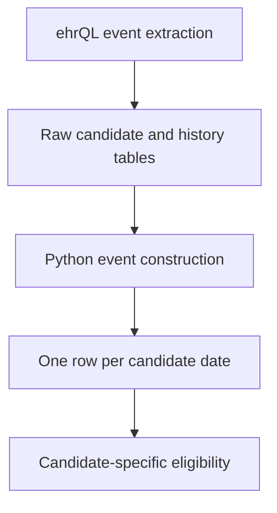

# Hip-fracture cohort development

## Document status

- **Project:** NICE osteoporosis MTA
- **Repository:** `NICE001-osteo-mta`
- **SAP version used:** v0.6
- **Current status:** Hip-fracture cohort QA prototype
- **Last updated:** 12 October 2026

This document describes the implementation and testing of the hip-fracture cohort prototype. It is intended to support technical review, team understanding and the later extension of the approach to other fracture types.

The current implementation is not yet the final analysis cohort. It uses dummy data and remains subject to changes arising from SAP review and OpenSAFELY technical advice.

## Aim

The immediate aim is to translate the fracture-cohort rules in SAP v0.6 into a reproducible OpenSAFELY pipeline.

Hip fracture is being used as the first prototype. The pipeline must identify candidate hip-fracture events, assess eligibility separately at every candidate date and allow the same patient to contribute more than one independently eligible index event.

The intended analytical unit is therefore a unique **patient–index fracture event**, rather than one row per patient.

## Current interpretation of the hip-fracture rules

The prototype currently applies the following rules:

1. A candidate hip-fracture index event is identified from an APCS hospital admission containing a hip-fracture ICD-10 code.
2. Diagnosis position is not relevant, so `apcs.all_diagnoses` is used.
3. Candidate dates must fall between 1 March 2019 and 31 January 2026.
4. Candidate dates within the specified COVID-wave exclusion periods are excluded.
5. A candidate must have no evidence of another hip fracture during the preceding six calendar months.
6. Hospital and GP records are both used to identify prior hip-fracture evidence.
7. A GP hip-fracture record does not itself generate a hip-fracture index event.
8. Same-day records are not treated as prior records because the lookback ends immediately before the candidate date.
9. Multiple APCS records for the same patient on the same admission date are treated as one candidate event.
10. The patient must be aged at least 18 on the candidate date.
11. One GP registration record must span the complete three-month period before the candidate date and include the candidate date.
12. Every candidate date is assessed independently. A patient may therefore contribute more than one eligible index event.

These rules reflect the current working interpretation of SAP v0.6 and should be checked again when the SAP is finalised.

## Study periods

Candidate hip-fracture admissions are restricted to:

- **Start:** 1 March 2019
- **End:** 31 January 2026

The following periods are excluded from candidate index dates:

- 23 March 2020 to 30 May 2020
- 7 September 2020 to 24 April 2021
- 28 May 2021 to 14 December 2021

These exclusions apply to candidate index dates only.

A hip-fracture hospital or GP record occurring during an excluded period can still contribute to the six-month history for a later candidate. The history tables must therefore not be restricted to the permitted candidate periods.

## Codelists

The hip-fracture prototype currently uses:

- `local_codelists/hip-fracture-incident-icd10-md.csv` for APCS hip-fracture admissions.
- `local_codelists/hip-fracture-incident-snomed-pm.csv` for GP hip-fracture records.

Codelists for vertebral, wrist and proximal humerus fractures have also been added to the repository but are not yet implemented in the event-level cohort pipeline.

## Six-month lookback definition

For each candidate index date, the prior-fracture window starts six calendar months before the index date and ends immediately before the index date.

This means:

- A record exactly six calendar months before the index date is included.
- A record on the index date is not included.
- Calendar-month arithmetic is used rather than a fixed number of days.
- Hospital and GP history are assessed separately and then combined.

The combined prior-fracture indicator is true when at least one hospital or GP hip-fracture record occurs within the window.

The candidate passes the six-month rule when no such record is present.

## Registration definition

For a candidate index date \(t\), a patient satisfies the current registration rule when a single GP registration record:

- Starts on or before \(t - 3\) calendar months; and
- Has no recorded end date, or ends on or after \(t\).

A registration beginning exactly three calendar months before the index date passes the rule.

The current code requires one registration period to span the complete interval. Separate registration records are not joined together to construct continuous registration.

## Age definition

Age is calculated separately at each candidate index date.

A candidate passes the age criterion when their age on the candidate date is at least 18 years.

A candidate occurring on or after the patient’s 18th birthday passes. A patient can therefore fail at an earlier candidate date and pass at a later date.

## Development approach

### Wide patient-level QA dataset

The first implementation uses the standard ehrQL structure of one row per patient.

It reconstructs up to ten distinct candidate hip dates for each patient and creates numbered QA variables for every candidate, including:

- Candidate date.
- Prior hospital-record count.
- Prior GP-record count.
- Prior-fracture indicator.
- Six-month-rule indicator.
- Age at the candidate date.
- Age-eligibility indicator.
- Three-month-registration indicator.
- Combined index-eligibility indicator.

It also creates an overflow indicator for patients with more than ten distinct candidate dates.

This wide dataset is retained for technical QA. Its numbered variables are not intended to form the final analytical dataset.

### Event-level prototype

The second implementation uses ehrQL event tables to extract:

- Candidate hip-fracture admissions.
- All available hip-fracture admission history.
- All available GP hip-fracture history.
- GP registration periods.
- Patient date of birth.

A downstream Python action converts these inputs into a long table containing one row per unique candidate hip-fracture date.

The downstream action:

1. Collapses multiple APCS records occurring on the same patient-date.
2. Sorts candidates chronologically.
3. Applies the hospital and GP six-month lookbacks.
4. Calculates age at each candidate date.
5. assesses three-month continuous registration.
6. Combines the eligibility criteria.
7. Retains the information required to identify every eligible index event.

## Pipeline structure



The relevant files are:

| File | Purpose |
|---|---|
| `analysis/dataset_definition.py` | Temporary wide patient-level QA dataset |
| `analysis/test_dataset_definition.py` | Hand-authored assurance data and expected results |
| `analysis/dataset_definition_event_level.py` | Event-level raw extraction prototype |
| `analysis/build_hip_event_cohort.py` | Construction of the long candidate-event table |
| `project.yaml` | Reproducible OpenSAFELY pipeline actions |

## Event-level input tables

The event-level ehrQL action produces the following files:

| Output | Purpose |
|---|---|
| `dataset.csv` | Patient-level data, including date of birth for QA |
| `candidate_hip_admissions.csv` | APCS records that can generate index candidates |
| `hip_admissions_history.csv` | Broader APCS hip-fracture history for lookbacks |
| `hip_gp_events_history.csv` | GP hip-fracture history for lookbacks |
| `practice_registrations.csv` | Registration periods used to assess continuity |

The history tables intentionally contain records outside the permitted index periods. These records may still affect the eligibility of a candidate occurring later.

## Long candidate-event table

The downstream action currently produces the following variables:

| Variable | Description |
|---|---|
| `patient_id` | Pseudonymised patient identifier |
| `candidate_event_id` | Technical identifier for the candidate row |
| `index_date` | Candidate hip-fracture date |
| `fracture_type` | Fracture type, currently fixed as `hip` |
| `index_source` | Index-record source, currently fixed as `hospital` |
| `candidate_hospital_record_count` | APCS records contributing to that patient-date candidate |
| `prior_hospital_record_count_6m` | Hospital records in the six-month lookback |
| `prior_hospital_date_count_6m` | Distinct hospital dates in the lookback |
| `prior_gp_record_count_6m` | GP records in the six-month lookback |
| `has_prior_same_type_fracture_6m` | Any prior hospital or GP hip-fracture evidence |
| `passes_6m_rule` | No prior hip-fracture evidence in the lookback |
| `age_at_index` | Patient age on the candidate date |
| `age_eligible` | Whether age is at least 18 |
| `has_3m_registration` | Whether registration spans the required interval |
| `is_eligible_index` | Combined current eligibility result |

The detailed source, time window, derivation and QA status of each variable will be maintained in `docs/variable_dictionary.csv`.

## Dummy-data assurance testing

The hand-authored assurance data test the following situations:

- A recent GP hip-fracture record causes a candidate to fail.
- GP records that are too old or occur after the candidate do not affect eligibility.
- A hospital admission occurring during an excluded COVID period still contributes to a later candidate’s lookback.
- An early candidate can fail while a later candidate passes.
- Multiple hospital records occurring on the same date are handled.
- A record exactly six calendar months before the candidate is included.
- A GP event on the candidate date is not treated as prior.
- A patient without a qualifying candidate admission is excluded from the population.
- Age eligibility can change between candidate dates.
- Registration eligibility can change between candidate dates.
- Exact age and registration boundaries are handled.
- Patients with more than ten candidate dates are identified by the wide QA overflow flag.

The ehrQL assurance tests currently report:

```text
Validate test data: All OK!
Validate results: All OK!
```

## End-to-end dummy pipeline result

The event-level dummy pipeline completed successfully and produced:

- 24 unique candidate hip-fracture event rows.
- 8 candidate events satisfying the currently implemented eligibility rules.

These figures are generated from synthetic dummy data. They are QA results only and must not be interpreted as patient counts or research findings.

## Running the current pipeline

The event-level cohort pipeline can be run locally using:

```bash
opensafely run build_hip_event_cohort -f
```

This forces the dependent ehrQL extraction to run before the downstream Python action.

The pipeline produces:

```text
output/hip_event_level_pipeline/
output/hip_candidate_events_long.csv
```

All patient-level outputs are declared `highly_sensitive`.

Generated outputs and metadata must not be committed to Git.

## Event-level permission

The event-level implementation uses:

```python
claim_permissions("event_level_data")
```

ehrQL event-level output is currently described as a trial feature for data-development work and is not generally available for research use.

Advice has been requested from the OpenSAFELY/ehrQL team about whether event-level extraction can be enabled for this project.

### If production permission is granted

The event-level extraction and downstream long-table approach can be retained. This would allow all candidate events to be represented without an arbitrary maximum number of dates per patient.

### If production permission is not granted

The validated wide patient-level method remains the fallback. Numbered candidate-date variables would be reshaped downstream into long format.

This approach would require:

- A sufficiently conservative maximum number of candidate dates.
- An overflow indicator.
- Aggregate QA of the number of patients exceeding the cap.
- Confirmation that the chosen cap does not materially omit eligible events.

The cohort must not be restricted to one event per patient unless the scientific team changes or clarifies the SAP requirement.

## Current limitations

The following limitations apply:

- Only hip fractures have been implemented.
- The work is based on dummy data.
- Event-level production permission has not been confirmed.
- The event-level and wide outputs have not yet been compared through an automated downstream consistency test.
- The complete set of research-eligibility criteria has not yet been implemented.
- Matching variables, baseline covariates, outcomes and censoring have not yet been added.
- The SAP remains under review and definitions may change.
- Wrist, vertebral and proximal humerus candidates have not yet been implemented.

## Decisions recorded so far

| Decision | Rationale |
|---|---|
| Use `apcs.all_diagnoses` | Diagnosis order is not relevant and the field includes the primary diagnosis |
| Use APCS hip admissions as hip index candidates | Current interpretation of SAP v0.6 |
| Use GP hip records for history | GP records can identify a recent prior hip fracture |
| Use calendar-month lookbacks | The rules are defined in months rather than a fixed number of days |
| Exclude the index date from prior history | Same-day evidence is not considered prior evidence |
| Collapse candidates by patient and date | Multiple APCS records may describe the same candidate date |
| Assess every candidate independently | A patient may contribute multiple eligible index events |
| Retain the wide dataset for QA | It provides a validated fallback and an independent comparison |
| Treat event-level output as provisional | Production permission remains pending |
| Mark outputs as highly sensitive | They contain patient-level records |

## Next steps

1. Create and populate the variable dictionary.
2. Add an automated wide-versus-long consistency check.
3. Obtain advice about production use of ehrQL event tables.
4. Update the implementation if the SAP definitions change.
5. Add remaining research-eligibility requirements.
6. Generalise the agreed approach to wrist, vertebral and proximal humerus fractures.
7. Add matching variables, baseline covariates, outcomes and censoring.
8. Produce disclosure-controlled aggregate QA outputs for the real-data pipeline.