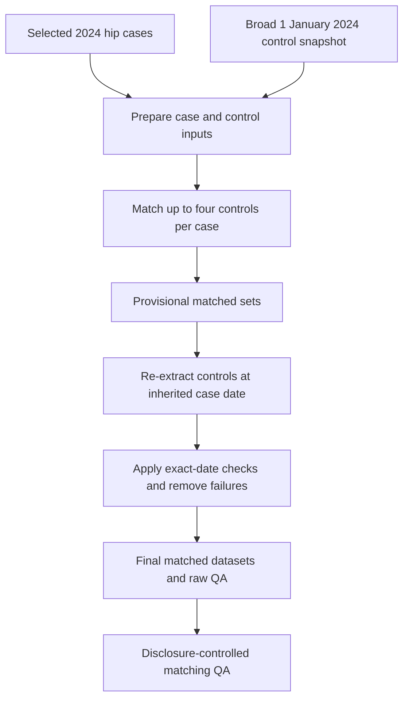

# Matching process, data structures and planned implementation

**Project:** NICE osteoporosis MTA

**Repository:** `opensafely/NICE001-osteo-mta`

**Integrated development branch:** `cohortbuild_md`

**Implementation history:** The 2024 hip pilot was developed on `matching_2024_hip` and merged into `cohortbuild_md` through PR #2 on 6 November 2026.

**Status:** The 2024 hip workflow is locally validated with dummy data but has not yet been run against real TPP data.

## 1. What this stage is doing

Stage 1 selects one eligible index-fracture event per patient for each fracture cohort. Stage 2 takes those selected cases and matches controls who resemble each case on specified characteristics.

The current Stage 2 prototype is for **hip fractures in calendar year 2024**. It matches up to four controls to each case using:

- sex;
- GP practice;
- care-home status;
- age within plus or minus three years.

The design uses a two-step approach:

1. Build a broad control pool at a common annual anchor date, currently 1 January 2024.
2. After provisional matching, give each control the case's actual index date and recheck every relevant attribute and eligibility rule on that exact date.

This is necessary because a person's age, practice, address, registration history and fracture history may differ between 1 January and the case's fracture date.

## 2. OpenSAFELY concepts used here

| Term                        | Meaning in this repository                                                                        |
| --------------------------- | ------------------------------------------------------------------------------------------------- |
| Action                      | One named unit in `project.yaml`, such as extracting a dataset or running a Python transformation |
| `needs`                     | The upstream actions that must finish before an action can run                                    |
| eHRQL dataset definition    | Python code describing which records and variables should be extracted from the TPP database      |
| Dummy data                  | Artificial local data used to test code without accessing patient records                         |
| Jobs workspace              | The secure OpenSAFELY workspace where actions are run against real TPP data                       |
| Airlock                     | The secure interface used to inspect sensitive working outputs                                    |
| Highly sensitive output     | Patient-level or otherwise disclosive output that remains inside the secure environment           |
| Moderately sensitive output | Aggregate working output that can be inspected in Airlock but is not automatically released       |

`project.yaml` is the pipeline map. If a final action is submitted on Jobs, OpenSAFELY follows its `needs` links and runs missing dependencies. Existing dependencies are reused unless **Force run dependencies** is selected.

The hip extraction and matching actions include `--test-data-file` and, for the end-to-end pilot, `--dummy-tables`. These options support local testing and are ignored when the dataset definition is run against real backend tables.

## 3. Current end-to-end matching flow



The important distinction is:

- **provisional match:** based on the annual snapshot;
- **final match:** retained only if the control still satisfies the matching and eligibility rules on the case's exact index date.

## 4. Actions, scripts, inputs and outputs

The actions below are defined in `project.yaml` on `cohortbuild_md`.

| Order | Action                                         | Code                                                                            | Main inputs                                             | Main outputs                                                        | Purpose                                                                                            |
| ----: | ---------------------------------------------- | ------------------------------------------------------------------------------- | ------------------------------------------------------- | ------------------------------------------------------------------- | -------------------------------------------------------------------------------------------------- |
|     1 | `select_hip_index_event`                       | `analysis/s1_cohort/hip/select_hip_index_event.py`                              | `output/dataset.csv.gz`                                 | `output/selected_hip_index_cases.csv`                               | Supplies one selected index event per hip case                                                     |
|     2 | `generate_hip_matching_attributes_2024`        | `analysis/s2_matching/hip/2024/dataset_definition_hip_matching_2024.py`         | TPP tables, or local dummy tables                       | `output/hip_matching_attributes_2024.csv.gz`                        | Creates the broad 1 January control pool and anchor-date attributes                                |
|     3 | `prepare_hip_matching_inputs_2024`             | `analysis/s2_matching/hip/2024/prepare_hip_matching_inputs_2024.py`             | Selected cases plus anchor attributes                   | Case and control matching CSV files plus raw QA                     | Restricts cases to 2024, standardises fields and removes selected 2024 cases from the control pool |
|     4 | `match_hip_2024`                               | OpenSAFELY `matching:v1.2.6` action                                             | Case and control matching CSV files                     | Provisional case, control and combined Arrow files; matching report | Selects up to four controls per case                                                               |
|     5 | `prepare_hip_matched_controls_for_ehrql_2024`  | `analysis/s2_matching/hip/2024/prepare_hip_matched_controls_for_ehrql_2024.py`  | Provisional control Arrow file                          | `output/hip_matched_controls_for_ehrql_2024.csv.gz`                 | Creates a small patient-ID, case-date and set-ID file for eHRQL                                    |
|     6 | `generate_hip_matched_control_attributes_2024` | `analysis/s2_matching/hip/2024/dataset_definition_hip_matched_controls_2024.py` | Matched-control file plus TPP tables                    | `output/hip_matched_control_attributes_2024.csv.gz`                 | Measures each provisional control on the inherited case date                                       |
|     7 | `finalise_hip_matches_2024`                    | `analysis/s2_matching/hip/2024/finalise_hip_matches_2024.py`                    | Provisional matching outputs plus exact-date attributes | Final case, control and combined Arrow files; raw QA                | Applies exact-date checks, drops failed controls and removes cases with no remaining controls      |
|     8 | `prepare_hip_matching_qa_2024`                 | `analysis/s2_matching/hip/2024/prepare_hip_matching_qa_2024.py`                 | Raw final matching QA                                   | `output/final_hip_matching_2024_qa_sdc.csv`                         | Redacts small counts and rounds remaining counts for Airlock inspection                            |

Submitting `prepare_hip_matching_qa_2024` is sufficient to request the complete matching dependency chain, provided all required upstream actions are available in that Jobs workspace.

## 5. Input and output structures

### 5.1 Selected hip cases from Stage 1

`output/selected_hip_index_cases.csv` contains one row per selected hip case:

| Field                                 | Meaning                                                           |
| ------------------------------------- | ----------------------------------------------------------------- |
| `patient_id`                          | OpenSAFELY patient identifier                                     |
| `index_date`                          | Selected hip-fracture date                                        |
| `fracture_type`                       | `hip`                                                             |
| `index_source`                        | `hospital`                                                        |
| `candidate_number`                    | Position of the selected candidate within the extracted dates     |
| `number_of_eligible_hip_index_events` | Number of eligible dates available before deterministic selection |
| `age_at_index`                        | Age on the exact selected date                                    |
| `sex`                                 | Patient sex                                                       |
| `practice_at_index`                   | GP practice on the exact selected date                            |
| `care_home_at_index`                  | Care-home classification on the exact selected date               |

### 5.2 Annual control-pool attributes

`output/hip_matching_attributes_2024.csv.gz` contains one row per potential control at the 1 January 2024 snapshot:

| Field                           | Meaning                                                            |
| ------------------------------- | ------------------------------------------------------------------ |
| `patient_id`                    | Patient identifier                                                 |
| `age`                           | Age on 1 January 2024                                              |
| `sex`                           | Sex used for matching                                              |
| `practice`                      | Practice on 1 January 2024                                         |
| `care_home`                     | Care-home status on 1 January 2024                                 |
| `has_6m_registration_at_anchor` | QA indicator for six months' continuous registration at the anchor |
| `no_hip_fracture_6m_anchor`     | QA indicator for no hip fracture in the anchor-date lookback       |

The pool intentionally remains broad. The anchor indicators are recorded for QA, but exact eligibility is applied after a control inherits a case date.

Patients aged 17 at the anchor can enter the broad pool because they may turn 18 before a later 2024 case date. Exact age is rechecked later.

### 5.3 Matching action inputs

Case input: `output/hip_cases_2024_matching.csv.gz`

```text
patient_id
index_date
fracture_type
age
sex
practice
care_home
```

Control input: `output/hip_potential_controls_2024_matching.csv.gz`

```text
patient_id
age
sex
practice
care_home
```

Cases missing any matching attribute are excluded before matching and counted in input QA. Patients selected as 2024 hip cases are excluded from the potential-control pool.

### 5.4 Provisional matching outputs

The matching action produces:

```text
output/matched_cases_hip_2024.arrow
output/matched_matches_hip_2024.arrow
output/matched_combined_hip_2024.arrow
output/matching_report_hip_2024.txt
```

The Arrow files contain the original matching variables plus identifiers created by the matching action, including `set_id`, `case`, `match_counts` and the inherited `index_date` for controls.

The report is aggregate working QA. It is not the final matched dataset.

### 5.5 Exact-date re-extraction input

`output/hip_matched_controls_for_ehrql_2024.csv.gz` contains only:

```text
patient_id
index_date
set_id
```

It is used with `table_from_file()` so that eHRQL can calculate each control's attributes using its matched case's date.

### 5.6 Exact-date control attributes

`output/hip_matched_control_attributes_2024.csv.gz` contains:

```text
patient_id
set_id
index_date
age_at_index
sex_at_index
practice_at_index
care_home_at_index
has_6m_registration_at_index
no_hip_fracture_6m_index
```

### 5.7 Final downstream schema

The final case, control and combined Arrow outputs share a deliberately small schema:

```text
patient_id
index_date
fracture_type
age
sex
practice
care_home
set_id
case
match_counts
```

`case` is `1` for a case and `0` for a control. `set_id` links the case to its controls. `match_counts` records the final number of retained controls in that set.

Internal validation fields are not carried into the final downstream dataset.

## 6. Current matching configuration

The `match_hip_2024` action currently specifies:

| Setting                                 | Value                              |
| --------------------------------------- | ---------------------------------- |
| Maximum controls per case               | 4                                  |
| Minimum controls required               | 1                                  |
| Exact categorical matches               | Sex, practice and care-home status |
| Age tolerance                           | Plus or minus three years          |
| Closest-match preference                | Age                                |
| Control index date                      | Case index date, with no offset    |
| Cases available as controls             | No                                 |
| Replacement after an exact-date failure | No                                 |

After exact-date validation, cases can therefore have one, two, three or four controls. Cases losing all provisional controls are excluded from the final matched output.

## 7. Exact-date checks

`finalise_hip_matches_2024.py` retains a provisional control only if all of the following are true on the inherited case date:

1. The re-extracted date agrees with the case and provisional matching dates.
2. The control is aged at least 18.
3. The control remains within three years of the case's age.
4. Sex agrees with the case.
5. GP practice agrees with the case.
6. Care-home status agrees with the case.
7. The control has six months' continuous registration.
8. The control has no hip-fracture record in the preceding six-month window through the control index date.

The final QA counts failures for each check, the number of cases losing every control and the distribution of final matching ratios.

## 8. Local validation completed

The dummy-data workflow deliberately created:

- one eligible case;
- four provisional controls;
- one provisional control with a hip fracture before the case date;
- one final case with three retained controls.

This confirmed that the matching action, inherited dates, exact-date re-extraction, removal without replacement and final variable ratio all work together locally.

The dummy tables are stored in:

```text
analysis/s2_matching/hip/2024/dummy_tables_hip_2024/
```

They contain artificial representations of the TPP tables required by the dataset definitions. They are test fixtures, not analysis inputs and not patient data.

## 9. Real-data validation still required

The matching code has been merged into `cohortbuild_md`, but the complete 2024 hip matching workflow has **not** yet been run against real TPP data.

The next developer should use the existing Jobs workspace attached to `cohortbuild_md`:

1. Confirm that the merged matching actions are visible in the workspace.
2. Submit `prepare_hip_matching_qa_2024`.
3. Select **Force run dependencies** so that the revised hip cohort and all matching inputs are regenerated from real TPP data.
4. Monitor the complete dependency chain on the Jobs site.
5. Inspect `output/matching_report_hip_2024.txt` and `output/final_hip_matching_2024_qa_sdc.csv` in Airlock.

No temporary matching workspace is now required. These are working process-QA outputs, so no release request is needed solely for this review.

The real-data review should examine:

- how many cases enter matching;
- how many receive four provisional controls;
- controls removed by each exact-date check;
- cases losing all controls;
- cases retaining one, two, three or four controls;
- whether losses cluster in older ages, care-home residents or small practices.

## 10. Planned all-years coding structure

The 2024 scripts are a validated prototype. The logic should be parameterised rather than copied into eight independent implementations.

Suggested structure:

```text
analysis/s2_matching/
├── config/
│   └── matching_periods.csv
├── shared/
│   ├── prepare_matching_inputs.py
│   ├── prepare_matched_controls_for_ehrql.py
│   ├── matched_control_dataset_helpers.py
│   ├── finalise_matches.py
│   └── prepare_matching_qa.py
└── hip/
    ├── dataset_definition_matching.py
    ├── dataset_definition_matched_controls.py
    ├── test_dataset_definition_matching.py
    └── dummy_tables/
```

`project.yaml` may still need explicit actions for each period because it is a static pipeline file. Those actions should call shared code with a fracture type and matching period, rather than duplicate the full logic.

### Proposed periods

| Matching year | Case period available from Stage 1     | Anchor         | Label                |
| ------------- | -------------------------------------- | -------------- | -------------------- |
| 2019          | March to December                      | 1 January 2019 | Partial opening year |
| 2020          | Dates remaining after COVID exclusions | 1 January 2020 | COVID-affected       |
| 2021          | Dates remaining after COVID exclusions | 1 January 2021 | COVID-affected       |
| 2022          | Full year                              | 1 January 2022 | Complete             |
| 2023          | Full year                              | 1 January 2023 | Complete             |
| 2024          | Full year                              | 1 January 2024 | Complete; pilot year |
| 2025          | Full year                              | 1 January 2025 | Complete             |
| 2026          | January only                           | 1 January 2026 | Partial closing year |

Stage 1 already removes COVID-excluded index dates. Stage 2 should consume the selected cases rather than repeat that calendar logic.

Recommended final fields include:

```text
matching_year
matching_period_complete
```

Preserving all periods allows the analysis team to exclude partial periods later without rerunning extraction and matching.

## 11. Extending matching to the other fracture cohorts

Do not copy the hip scripts unchanged. Before adding wrist, vertebral or proximal-humerus matching:

1. Confirm that the 2024 hip design has passed technical and real-data review.
2. Add exact case-date sex, practice and care-home attributes to the selected outputs for the other cohorts, or create a separate exact-date case-attribute extraction.
3. Parameterise fracture-specific codelists and prior-fracture checks.
4. Preserve `index_source` for cohorts where GP and hospital records can both define the index event.
5. Produce fracture-by-year QA before combining outputs.

## 12. Recommended pickup order

1. Confirm that the merged matching actions are available from the `cohortbuild_md` Jobs workspace.
2. Confirm the methodological settings in Section 6.
3. Run the hip-2024 pipeline on TPP with **Force run dependencies**.
4. Review matching performance in Airlock.
5. Parameterise hip matching across all periods.
6. Run consolidated all-years hip QA.
7. Extend the reviewed design to wrist, vertebral and proximal humerus.
8. Build case-mix and subsequent-fracture outcome datasets from the final matched structure.

## 13. Data-handling reminder

Patient-level matching files, exact logs and raw QA must remain in the secure environment. Disclosure-controlled working QA can be inspected in Airlock but should not be committed to GitHub unless it has completed the appropriate output-release process.
