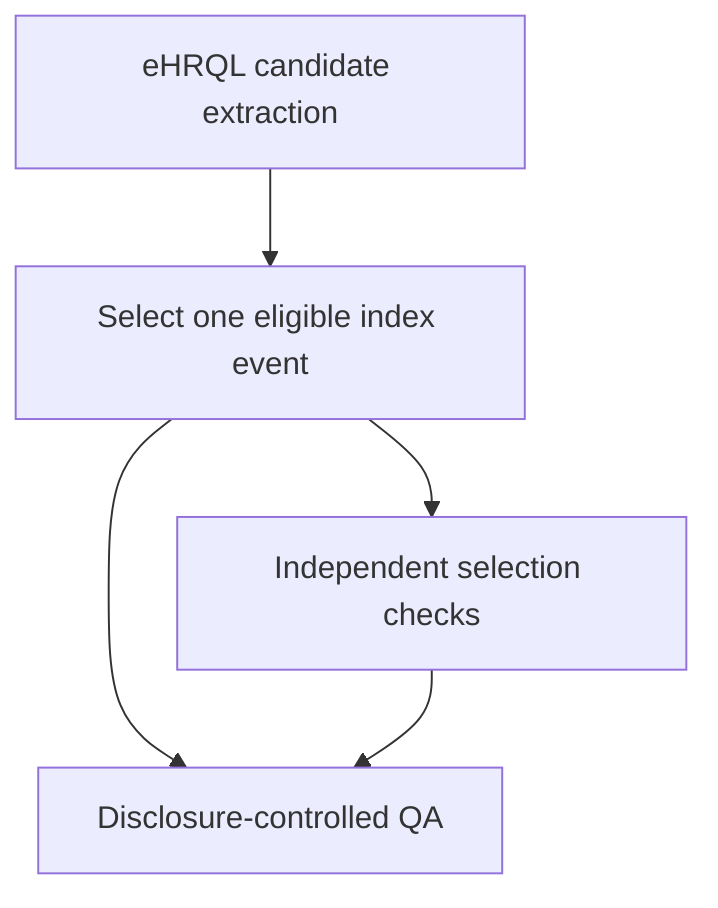

# Repository organisation and cohort-selection script guide

**Project:** NICE osteoporosis MTA

**Repository:** `opensafely/NICE001-osteo-mta`

**Shared development branch:** `cohortbuild_md`

**Scope:** Repository structure and Stage 1 index-cohort scripts. Matching is described separately in `matching_process_guide.md`.

## 1. How to read this repository

The repository contains code and configuration, not the real patient data. OpenSAFELY uses the repository to determine what should run inside the secure environment.

The central file is `project.yaml`. It defines:

- the named actions shown on the Jobs site;
- which software action runs each script;
- the dependency order through `needs`;
- the input and output paths used between actions;
- the sensitivity classification of each output.

The Python scripts under `analysis/` perform two different jobs:

1. **eHRQL dataset definitions** specify what should be extracted from TPP tables.
2. **Ordinary Python scripts** reshape, select, validate, and apply disclosure control to the extracted data.

The output of one action becomes the input of the next. The `output/` directory is generated when actions run and is not part of the source-code structure.

## 2. Repository map

```text
NICE001-osteo-mta/
├── project.yaml
├── README.md
├── LICENSE
├── analysis/
│   ├── s1_cohort/
│   │   ├── shared/
│   │   │   └── prepare_selection_qa.py
│   │   ├── hip/
│   │   ├── wrist/
│   │   ├── vertebral/
│   │   └── prox_humerus/
│   └── s2_matching/
│       └── hip/2024/
├── local_codelists/
├── codelists/
└── docs/
```

### What each top-level item is for

| Path                       | Purpose                                                                      |
| -------------------------- | ---------------------------------------------------------------------------- |
| `project.yaml`             | Defines the complete action pipeline and output sensitivity levels           |
| `analysis/s1_cohort/`      | Builds and validates the four index-fracture cohorts                         |
| `analysis/s2_matching/`    | Contains the current 2024 hip matching prototype                             |
| `local_codelists/`         | Project-specific ICD-10 and SNOMED codelist CSV files used directly by eHRQL |
| `codelists/codelists.txt`  | Human-readable codelist manifest                                             |
| `codelists/codelists.json` | Machine-readable codelist manifest                                           |
| `docs/`                    | Technical documentation and handover guides                                  |
| `README.md`                | Standard OpenSAFELY repository warning and project link                      |

## 3. Stage 1 cohort-building pattern

Each fracture cohort follows the same broad four-action pattern:



The four stages are:

1. Extract up to 15 distinct candidate dates per permitted source, together with eligibility information.
2. Combine same-day sources where necessary and select one eligible date per patient using a deterministic hash.
3. Reconstruct the expected result independently and assert that the selected output is correct.
4. Convert raw QA counts into an Airlock-viewable disclosure-controlled table.

Running the final `prepare_*_selection_qa` action requests this full chain when its upstream outputs do not already exist.

## 4. Rules common to all four cohorts

The current code implements:

- candidate dates from 1 March 2019 to 31 January 2026;
- exclusion of specified COVID-wave index-date periods;
- age at least 18 on the candidate date;
- six months' continuous GP registration spanning the candidate date;
- no same-type fracture in the preceding six calendar months;
- hospital and GP records used for the six-month fracture-history check;
- same-day records not treated as prior records because the lookback ends before the candidate date;
- one selected eligible index event per patient;
- reproducible pseudo-random selection using a fixed hash seed;
- exclusion of patients whose full candidate history cannot be represented within the 15-date-per-source limit.

The COVID exclusions apply to potential index dates only. A fracture record occurring during an excluded period can still count as fracture history for a later candidate date.

## 5. Differences between fracture cohorts

| Cohort           | Permitted index-event sources        | Same-day source handling                                  | Current selected output includes matching attributes? |
| ---------------- | ------------------------------------ | --------------------------------------------------------- | ----------------------------------------------------- |
| Hip              | Hospital APCS only                   | Not applicable; GP records do not create hip index events | Yes: age, sex, practice and care-home status          |
| Wrist            | Hospital APCS and GP clinical events | Same-day hospital and GP records are combined as `both`   | Age only                                              |
| Vertebral        | Hospital APCS and GP clinical events | Same-day hospital and GP records are combined as `both`   | Age only                                              |
| Proximal humerus | Hospital APCS and GP clinical events | Same-day hospital and GP records are combined as `both`   | Age only                                              |

This difference matters for future matching work. The other three cohorts will need exact case-date sex, practice and care-home attributes added before the hip matching design can be reused.

## 6. Hip cohort files

### `analysis/s1_cohort/hip/dataset_definition.py`

Type: eHRQL dataset definition.

Purpose:

- identifies hospital admissions containing a hip-fracture ICD-10 code in `apcs.all_diagnoses`;
- limits candidate index dates to the study periods;
- extracts up to 15 distinct hospital candidate dates per patient;
- calculates six-month hospital and GP hip-fracture history for each date;
- calculates age, practice, care-home status and six-month registration at each candidate date;
- records whether more than 15 distinct candidate dates exist.

Population: patients with at least one candidate hip admission.

Main output: `output/dataset.csv.gz` through the `generate_dataset` action.

The name `dataset.csv.gz` is historical and less descriptive than the other cohort outputs. It is the hip candidate dataset.

### `analysis/s1_cohort/hip/test_dataset_definition.py`

Type: eHRQL test-data definition.

Purpose: supplies artificial test patients and expected values so eHRQL can test the hip extraction logic locally.

### `analysis/s1_cohort/hip/select_hip_index_event.py`

Type: ordinary Python/pandas transformation.

Input: `output/dataset.csv.gz`.

Purpose:

- reshapes the 15 wide candidate slots into candidate rows;
- keeps eligible candidate dates;
- excludes patients with candidate overflow;
- assigns each candidate a deterministic SHA-256 selection score;
- selects one date per patient;
- retains the exact-date matching attributes needed downstream.

Outputs:

- `output/selected_hip_index_cases.csv`;
- `output/selected_hip_index_cases_qa.csv`.

Selected output fields:

```text
patient_id
index_date
fracture_type
index_source
candidate_number
number_of_eligible_hip_index_events
age_at_index
sex
practice_at_index
care_home_at_index
```

### `analysis/s1_cohort/hip/check_hip_index_selection.py`

Type: independent process check.

Inputs: hip candidate dataset and selected hip cases.

Purpose: reconstructs the selection, asserts one row per patient, confirms the selected date and attributes, and confirms deterministic selection.

Output: `output/hip_index_selection_check.txt`.

## 7. Wrist cohort files

### `analysis/s1_cohort/wrist/dataset_definition_wrist.py`

Type: eHRQL dataset definition.

Purpose:

- extracts hospital and GP wrist-fracture candidate dates;
- extracts up to 15 distinct dates from each source;
- evaluates age, registration and six-month same-type fracture history at each date;
- records separate hospital and GP overflow flags.

Main output: `output/wrist_candidates.csv.gz`.

### `analysis/s1_cohort/wrist/test_dataset_definition_wrist.py`

Supplies artificial test patients and expected values for the wrist dataset definition.

### `analysis/s1_cohort/wrist/select_wrist_index_event.py`

Input: `output/wrist_candidates.csv.gz`.

Purpose:

- reshapes hospital and GP candidate slots into rows;
- combines records with the same patient and date;
- labels the source as `hospital`, `gp` or `both`;
- excludes patients with overflow in either source;
- selects one eligible date per patient reproducibly.

Outputs:

- `output/selected_wrist_index_cases.csv`;
- `output/selected_wrist_index_cases_qa.csv`.

Selected output fields:

```text
patient_id
index_date
fracture_type
index_source
number_of_eligible_wrist_index_events
age_at_index
```

### `analysis/s1_cohort/wrist/check_wrist_index_selection.py`

Reconstructs the selected output and QA, confirms same-day source combination and confirms one reproducibly selected date per patient.

Output: `output/wrist_index_selection_check.txt`.

## 8. Vertebral cohort files

The vertebral scripts use the same structure as wrist, with vertebral codelists and variable names.

| File                                   | Role                                                                           |
| -------------------------------------- | ------------------------------------------------------------------------------ |
| `dataset_definition_vertebral.py`      | Extracts up to 15 hospital and 15 GP candidate dates and evaluates eligibility |
| `test_dataset_definition_vertebral.py` | Provides artificial eHRQL test patients and expected values                    |
| `select_vertebral_index_event.py`      | Combines sources, excludes overflow and selects one eligible date per patient  |
| `check_vertebral_index_selection.py`   | Reconstructs and validates selection and QA                                    |

Main outputs:

```text
output/vertebral_candidates.csv.gz
output/selected_vertebral_index_cases.csv
output/selected_vertebral_index_cases_qa.csv
output/vertebral_index_selection_check.txt
```

The selected-case schema is the same as wrist, replacing the fracture-specific event-count field with `number_of_eligible_vertebral_index_events`.

Airlock QA showed that vertebral overflow (eligible candidate dates higher than 15) was higher (\~400) than in other cohorts (mostly very few or redacted). It was mainly associated with hospital records (affecting about 0.4% of otherwise eligible patients). Since the threshold worked well for other cohorts and the impact on the final number of cases is negligible, we may not need to review this further or make any coding changes.&#x20;

## 9. Proximal-humerus cohort files

The proximal-humerus scripts also follow the wrist structure.

| File                                      | Role                                                                          |
| ----------------------------------------- | ----------------------------------------------------------------------------- |
| `dataset_definition_prox_humerus.py`      | Extracts hospital and GP candidates and evaluates eligibility                 |
| `test_dataset_definition_prox_humerus.py` | Provides artificial eHRQL test patients and expected values                   |
| `select_prox_humerus_index_event.py`      | Combines sources, excludes overflow and selects one eligible date per patient |
| `check_prox_humerus_index_selection.py`   | Reconstructs and validates selection and QA                                   |

Main outputs:

```text
output/prox_humerus_candidates.csv.gz
output/selected_prox_humerus_index_cases.csv
output/selected_prox_humerus_index_cases_qa.csv
output/prox_humerus_index_selection_check.txt
```

The selected-case schema replaces the event-count field with `number_of_eligible_prox_humerus_index_events`.

## 10. Shared selection-QA file

### `analysis/s1_cohort/shared/prepare_selection_qa.py`

This script is shared by all four cohorts. It takes a fracture type as a command-line argument, reads:

```text
output/selected_<fracture_type>_index_cases_qa.csv
```

and writes:

```text
output/selected_<fracture_type>_index_cases_qa_sdc.csv
```

Disclosure control:

- zero remains `0`;
- counts from 1 to 7 become `[REDACTED]`;
- remaining counts are rounded to the nearest five.

The raw QA is highly sensitive. The transformed QA is marked moderately sensitive for working review in Airlock.

## 11. Stage 1 actions in `project.yaml`

| Cohort           | Extract                            | Select                            | Check                                | Disclosure-controlled QA            |
| ---------------- | ---------------------------------- | --------------------------------- | ------------------------------------ | ----------------------------------- |
| Hip              | `generate_dataset`                 | `select_hip_index_event`          | `check_hip_index_selection`          | `prepare_hip_selection_qa`          |
| Wrist            | `generate_wrist_candidates`        | `select_wrist_index_event`        | `check_wrist_index_selection`        | `prepare_wrist_selection_qa`        |
| Vertebral        | `generate_vertebral_candidates`    | `select_vertebral_index_event`    | `check_vertebral_index_selection`    | `prepare_vertebral_selection_qa`    |
| Proximal humerus | `generate_prox_humerus_candidates` | `select_prox_humerus_index_event` | `check_prox_humerus_index_selection` | `prepare_prox_humerus_selection_qa` |

To request a complete cohort chain on Jobs, select its final QA action. OpenSAFELY will run missing dependencies. Select **Force run dependencies** if an upstream script changed but older outputs already exist in the workspace.

## 12. Candidate-data structure

The eHRQL outputs are intentionally wide because the current OpenSAFELY route extracts a fixed maximum number of candidate dates per patient.

### Hip

One row per patient, with repeated groups such as:

```text
candidate_hip_date_1
candidate_hip_age_1
candidate_hip_practice_1
candidate_hip_care_home_1
candidate_hip_has_6m_registration_1
candidate_hip_is_eligible_index_1
...
candidate_hip_date_15
```

Hip has one overflow flag because only hospital records generate index candidates.

### Wrist, vertebral and proximal humerus

One row per patient, with separate repeated groups for hospital and GP records:

```text
candidate_<fracture>_hospital_1_date
candidate_<fracture>_hospital_1_age
candidate_<fracture>_hospital_1_is_eligible_index
...
candidate_<fracture>_gp_15_date
candidate_<fracture>_gp_15_age
candidate_<fracture>_gp_15_is_eligible_index
```

They have separate hospital and GP overflow flags. The selection scripts convert this wide structure into a long list of candidate patient-dates, combine same-day sources and then select one row per patient.

## 13. Codelists

The current project-specific files are:

```text
local_codelists/hip-fracture-incident-icd10-md.csv
local_codelists/hip-fracture-incident-snomed-pm.csv
local_codelists/wrist-fracture-incident-icd10-xi.csv
local_codelists/wrist-fracture-incident-snomed-xi.csv
local_codelists/vertebral-fracture-incident-icd10-xi.csv
local_codelists/vertebral-fracture-incident-snomed-pm.csv
local_codelists/prox-humerus-fracture-incident-icd10-xi.csv
local_codelists/prox-humerus-fracture-incident-snomed-xi.csv
```

ICD-10 codelists are applied to `apcs.all_diagnoses`, so diagnosis position is not restricted. SNOMED codelists are applied to GP `clinical_events`.

Do not edit a codelist without recording the clinical or SAP decision behind the change and updating its tests.

## 14. Tests and dummy data

There are two related but different testing mechanisms:

### eHRQL test-data files

Each `test_dataset_definition*.py` file defines small artificial patient histories plus expected output columns. These test the individual dataset definition.

### Matching dummy tables

`analysis/s2_matching/hip/2024/dummy_tables_hip_2024/` contains artificial CSV representations of the TPP tables. These allow several eHRQL and downstream actions to run together as an end-to-end local pipeline.

The `--dummy-tables` option in `project.yaml` supports local testing. It is ignored when eHRQL runs against real backend tables.

## 15. Output sensitivity and where files can be viewed

| Output type                              | Examples                                    | Where it belongs                                        |
| ---------------------------------------- | ------------------------------------------- | ------------------------------------------------------- |
| Patient-level candidate or selected data | Candidate CSV files; selected index cases   | Highly sensitive; secure environment only               |
| Raw QA                                   | Unrounded counts; exact selection reports   | Highly sensitive; secure environment only               |
| Disclosure-controlled QA                 | `*_qa_sdc.csv`                              | Moderately sensitive working output; inspect in Airlock |
| Released output                          | Output approved through the release process | May be available through the Jobs site after approval   |

Successful action logs on the Jobs site confirm that code ran, but sensitive output contents are viewed only through the appropriate secure interface.

## 16. Current status and known limitations

- All four Stage 1 selection chains have run successfully on TPP and their disclosure-controlled QA has been inspected in Airlock.
- The 15 candidate-date limit is an agreed project rule. Overflow patients are excluded. Subject to further QA/review.
- The 2024 hip matching branch contains additional exact-date attributes in the hip selected-case output.
- The selected outputs for wrist, vertebral and proximal humerus currently contain age but not sex, practice or care-home status.
- This guide is the current technical explanation of the Stage 1 scripts and should be updated whenever the cohort-building structure or rules change.

## 17. Suggested workflow for a new developer

1. Read `project.yaml` to understand action order and output paths.
2. Read the relevant fracture's `dataset_definition` and test file together.
3. Read its `select_*_index_event.py` script to understand how the wide candidates become one selected event.
4. Read the corresponding `check_*` script before changing selection logic.
5. Run the relevant final QA action locally using dummy data.
6. Create a short-lived feature branch from the latest `cohortbuild_md`.
7. Commit code and tests together.
8. Open a PR back into `cohortbuild_md`.
9. Use a temporary Jobs workspace only when unmerged code genuinely requires real-data testing.

## 18. Related guide

See `docs/matching_process_guide.md` for:

- the 2024 hip matching pipeline;
- matching input and output schemas;
- exact-date validation;
- real-data validation routes;
- the planned all-years and all-fracture implementation.
